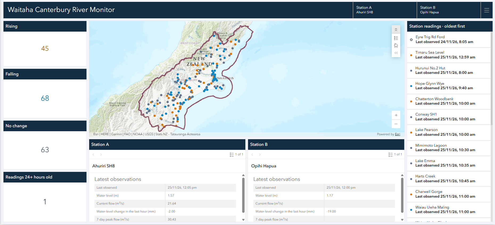
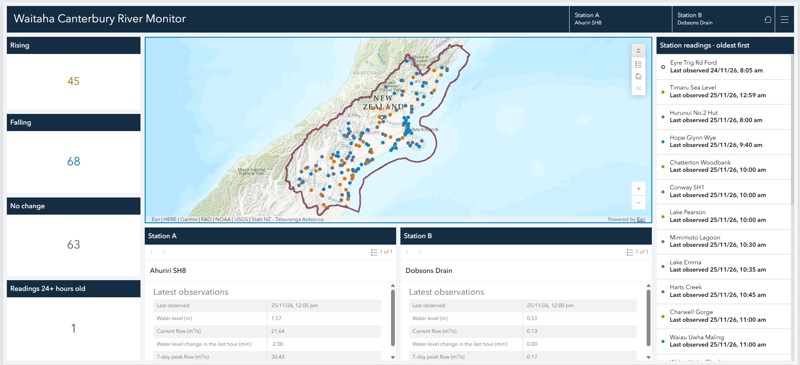

# Waitaha Canterbury River Monitor

A regional dashboard for exploring Environment Canterbury's provisional monitoring observations. Zoom or pan to update the status cards and station list. Click a card to filter the gauges in view. Pin any two gauges to compare their latest reported water level, current flow, hourly water-level change and seven-day peak flow. A missing measurement displays as “Not reported”.

Select a gauge on the map or a station in the readings list to see its latest observations. Use the A and B buttons to pin stations for comparison.

## Run the dashboard

Serve this folder over HTTP, for example with `python -m http.server 8000`, and visit <http://localhost:8000/>. For GitHub Pages, publish the repository root. The app is static and needs no API key, build step or ArcGIS Online account. Leaflet, OpenStreetMap tiles and the monitoring feed require internet access.

## Data and refresh

- [Environment Canterbury river flow data](https://www.ecan.govt.nz/data/riverflow) and [live feature service](https://gis1.ecan.govt.nz/arcgis/rest/services/Public/WaterQualityandMonitoring/FeatureServer/12). Observations are provisional. The app queries the source at startup and every five minutes, and users can refresh manually.
- [Stats NZ Regional Council 2025](https://services2.arcgis.com/vKb0s8tBIA3bdocZ/arcgis/rest/services/Regional_Council_2025/FeatureServer/0). The bundled Canterbury polygon is the full administrative boundary, including offshore areas. Browser-side point-in-polygon filtering runs on every successful feed refresh. The dashboard is a monitoring snapshot and does not contain historical time series.
- The app distinguishes the time it last fetched the feed from observation times at individual stations. A failed refresh leaves the last successful dataset visible and shows a warning. A successful response is also cached in the browser for return visits.
- Observations aged 24 hours or more are classified as older. A recent missing hourly change is classified as no trend data. A reported zero is classified as no change. The same logic powers the map, cards and list.

## ArcGIS Online prototype

The original dashboard used a spatial selection and a live layer filter. The standalone app recomputes geographic membership against the full Stats NZ polygon and excludes two stations that were outside the prototype selection: Waiau Toa/Clarence (62107) and Ahuriri Sth Diadem (71116). This matches the 177-station prototype against the tested feed, while allowing the count to change when ECan adds or removes other stations.

[Watch the ArcGIS dashboard walkthrough](docs/arcgis-demo.mp4)
